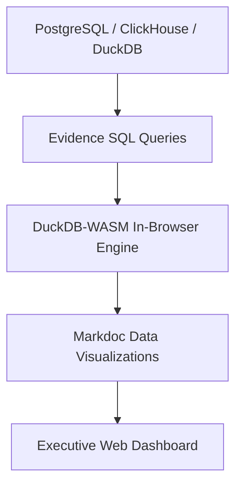

  

<h1 align="center">CapellaBI</h1>
<h3 align="center">Executive Intelligence & AI Unit Economics Cockpit</h3>

  <strong>The Golden Star of High-Precision Business Intelligence & Telemetry</strong> 
  Ultra-fast BI-as-Code dashboard delivering real-time telemetry, margin analysis, and agent token unit economics.

  
  
  
  
  

---

## 📖 Executive Overview

**CapellaBI** (named after Alpha Aurigae, the brilliant golden quadruple star system) is an enterprise-grade Business Intelligence platform built on the modern **BI-as-Code** paradigm. 

Instead of paying \$50+/user/month for rigid legacy tools like Tableau, Looker, or PowerBI, CapellaBI compiles SQL queries and Markdown components into an interactive, ultra-fast analytics portal that executes in-browser using **DuckDB-WASM** with zero database latency.

---

## ✨ Key Capabilities

- **Sub-50ms In-Browser Analytics:** Powered by DuckDB-WASM, allowing instant multi-dimensional slicing, sorting, and filtering with zero server round-trips.
- **Executive Revenue Telemetry:** Real-time ARR tracking, blended gross margin breakdown, and AI turn latency distributions.
- **Autonomous Agent Economics:** Granular cost telemetry comparing Groq Llama-3.3, Google Gemini Flash, and real-time voice streams.
- **Enterprise Client Ledger:** Track enterprise contract retainers, active tiers, and MRR contributions across client deployments.
- **Cloud & Container Deployments:** Pre-configured for zero-cost deployment on Vercel or Render free web service.

---

## 🛠️ Architecture & Tech Stack

- **Framework:** Evidence.dev 0.12 (BI-as-Code)
- **Engine:** DuckDB-WASM / PostgreSQL direct connector
- **Components:** Markdoc Data Visualizations (``, ``, ``)
- **Hosting:** Vercel (Container Functions) or Render Free Web Service

---

## 🚀 Deployment Guide

### Option A: 1-Click Deploy to Vercel
1. Fork or import `wtfear/NexusBI` to [vercel.com/new](https://vercel.com/new).
2. Vercel automatically detects `Dockerfile.vercel`.
3. Set Environment Variables:
   - `EVIDENCE_AUTH_DISABLED`: `true`
4. Click **Deploy**.

### Option B: Deploy to Render Free Web Service ($0/mo)
1. Go to [dashboard.render.com](https://dashboard.render.com) $\rightarrow$ **New Web Service**.
2. Connect `wtfear/NexusBI`.
3. Render automatically picks up `render.yaml` or `Dockerfile`.
4. Instance Type: **Free** (0.5 CPU / 512 MB RAM).
5. Click **Deploy**.

---

## 🌌 The WTFear Celestial Enterprise Portfolio

CapellaBI anchors the financial analytics tier of the **WTFear Celestial AI Suite**:

| Star | Flagship Platform | Category | Stack |
|---|---|---|---|
| 🌟 **Capella** | **`CapellaBI`** | BI-as-Code & Unit Economics Cockpit | DuckDB-WASM, Svelte, SQL |
| 🌟 **Polaris** | **`PolarisERP`** | Autonomous Enterprise ERP, CRM & WMS | Next.js 15, PostgreSQL, TurboRepo |
| 🌟 **Aldebaran** | **`AldebaranCRM`** | Enterprise Sales Pipeline & Quotation CRM | Laravel, Vue.js, MySQL |
| 🌟 **Altair** | **`AltairCommerce`** | Headless B2B/D2C Commerce Engine | Laravel 11/12, Vue.js, MySQL |
| 🌟 **Vega** | **`VegaDocs`** | Air-Gapped Document Intelligence & RAG | React, Node.js, Vector DBs |
| 🌟 **Sirius** | **`SiriusIQ`** | Enterprise Workplace Knowledge OS & RAG | Next.js, FastAPI, Vespa, PostgreSQL |

---

## 📄 License & Attribution

- **Core Framework License:** [MIT License](./LICENSE) — 100% Free for commercial and agency white-label deployments.
- **Maintained by:** [WTFear Agency](https://github.com/wtfear) & **Pavan Kumar Kunukuntla**.
