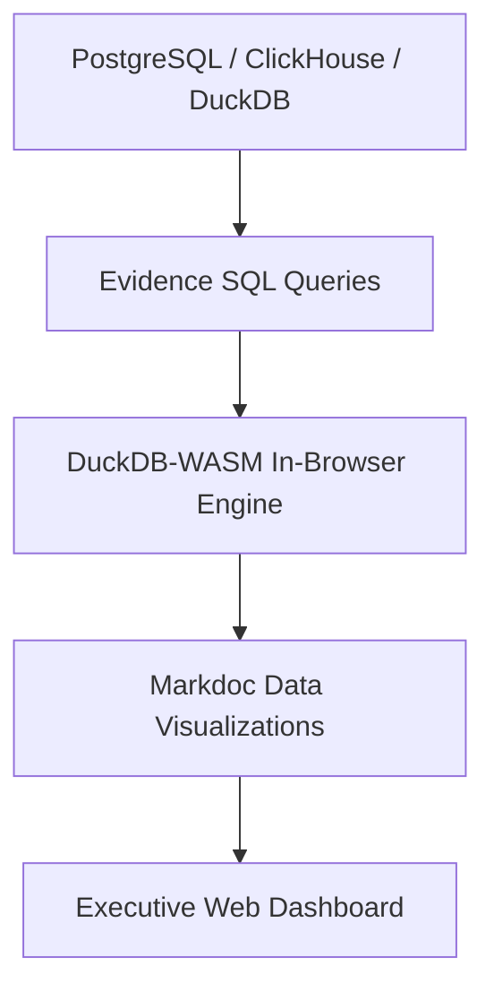

<p align="center">
  
</p>

<h1 align="center">CapellaBI</h1>
<h3 align="center">Executive Revenue & AI Unit Economics Cockpit</h3>

<p align="center">
  <strong>The Golden Star of High-Precision Business Intelligence & Telemetry</strong><br />
  Ultra-fast BI-as-Code dashboard delivering real-time telemetry, margin analysis, and agent token unit economics.
</p>

<p align="center">
  <a href="https://github.com/wtfear"></a>
  <a href="https://evidence.dev"></a>
  <a href="https://duckdb.org"></a>
  <a href="./LICENSE"></a>
  <a href="https://vercel.com"></a>
</p>

---

## 📖 Executive Overview

**CapellaBI** (named after Alpha Aurigae, the brilliant golden quadruple star system) is an enterprise-grade Business Intelligence platform built on the modern **BI-as-Code** paradigm. 

Instead of paying $50+/user/month for rigid legacy tools like Tableau, Looker, or PowerBI, CapellaBI compiles SQL queries and Markdown components into an interactive, ultra-fast analytics portal that executes in-browser using **DuckDB-WASM** with zero database latency.

---

## ✨ Key Capabilities

- **Sub-50ms In-Browser Analytics:** Powered by DuckDB-WASM, allowing instant multi-dimensional slicing, sorting, and filtering with zero server round-trips.
- **Executive Revenue Telemetry:** Real-time ARR tracking ($1.48M ARR, +42.8% YoY), blended gross margin breakdown (84.6%), and AI turn latency distributions.
- **Autonomous Agent Economics:** Granular cost telemetry comparing Groq Llama-3.3, Google Gemini Flash, Deepgram Nova-2, and Cartesia Sonic voice streams.
- **Enterprise Client Ledger:** Track enterprise contract retainers, active tiers, and MRR contributions across client deployments.
- **Zero-Cost Free Deployments:** Pre-configured for $0/month deployment on Vercel, Cloudflare Pages, Netlify, or Render.

---

## 🛠️ Architecture & Tech Stack



- **Framework:** Evidence.dev 0.12 (BI-as-Code) + Static Edge Bundle
- **Engine:** DuckDB-WASM / In-Browser Universal SQL
- **Components:** Interactive Canvas/SVG Visualizations, Responsive Tailwind UI, In-Browser SQL Console
- **Hosting:** Vercel (Edge CDN), Cloudflare Pages, Netlify, or Render Free Container

---

## 🚀 Deployment Guide (100% Free Tiers)

### Option 1: Vercel (Recommended — $0/mo Forever, Zero Cold Starts)
1. Fork or import `wtfear/CapellaBI` to [vercel.com/new](https://vercel.com/new).
2. Configure Project Settings:
   - **Framework Preset:** `Other` (or `Vite`)
   - **Build Command:** `npm run build`
   - **Output Directory:** `dist`
3. Click **Deploy**.
4. Your live dashboard is immediately published at `https://capellabi.vercel.app` (or connect your custom domain `bi.wtfear.agency` in Vercel Settings).

### Option 2: Cloudflare Pages (Free Forever, Unlimited Bandwidth)
1. Go to [dash.cloudflare.com](https://dash.cloudflare.com) → **Workers & Pages** → **Create application** → **Pages** → **Connect to Git**.
2. Select `wtfear/CapellaBI`.
3. Configure Build Settings:
   - **Framework preset:** `None`
   - **Build command:** `npm run build`
   - **Build output directory:** `dist`
4. Click **Save and Deploy**.

### Option 3: Render Free Container Web Service ($0/mo)
1. Go to [dashboard.render.com](https://dashboard.render.com) → **New Web Service**.
2. Connect `wtfear/CapellaBI`.
3. Render automatically picks up `render.yaml` or `Dockerfile`.
4. Instance Type: **Free** (0.5 CPU / 512 MB RAM).
5. Environment Variables:
   - `EVIDENCE_AUTH_DISABLED`: `true`
   - `PORT`: `3000`
6. Click **Deploy**.

---

## 💻 Local Development

```bash
# Clone the repository
git clone https://github.com/wtfear/CapellaBI.git
cd CapellaBI

# Build static distribution
npm run build

# Start local preview server (port 3000)
npx serve dist -l 3000
```

---

## 🌌 The WTFear Celestial Enterprise Portfolio

CapellaBI anchors the financial analytics tier of the **WTFear Celestial AI Suite**:

| Star | Flagship Platform | Category | Stack |
|---|---|---|---|
| 🌟 **Capella** | **`CapellaBI`** | BI-as-Code & Unit Economics Cockpit | DuckDB-WASM, Svelte, SQL |
| 🌟 **Polaris** | **`PolarisERP`** | Autonomous Enterprise ERP, CRM & WMS | Next.js 15, PostgreSQL, TurboRepo |
| 🌟 **Aldebaran** | **`AldebaranCRM`** | Enterprise Sales Pipeline & Quotation CRM | Laravel, Vue.js, MySQL |
| 🌟 **Altair** | **`AltairCommerce`** | Headless B2B/D2C Commerce Engine | Laravel 11/12, Vue.js, MySQL |
| 🌟 **Vega** | **`VegaDocs`** | Air-Gapped Document Intelligence & RAG | React, Node.js, Vector DBs |
| 🌟 **Sirius** | **`SiriusIQ`** | Enterprise Workplace Knowledge OS & RAG | Next.js, FastAPI, Vespa, PostgreSQL |
| 🌟 **Castor** | **`CastorChat`** | Omnichannel WhatsApp & Customer Desk | Rails 7.2, Vue 3, PostgreSQL |
| 🌟 **Arcturus** | **`ArcturusFlow`** | Sovereign AI Agent Automation Engine | TypeScript, Angular, PostgreSQL |
| 🌟 **Spica** | **`SpicaAnalytics`** | Privacy-First Sovereign Web Telemetry | Next.js 15, Prisma, PostgreSQL |
| 🌟 **Antares** | **`AntaresERP`** | Enterprise Operations & POS Engine | Laravel 13, FilamentPHP 5, MySQL |
| 🌟 **Deneb** | **`DenebCMS`** | Native Next.js 15 Headless CMS | Next.js 15, TypeScript, Drizzle |
| 🌟 **Mintaka** | **`MintakaSchedule`** | Autonomous Scheduling Engine | Next.js, Prisma, tRPC |
| 🌟 **Bellatrix** | **`BellatrixPortal`** | Enterprise Admin & Client Portal OS | React 19, TypeScript, AntD |
| 🌟 **Lyra** | **`LyraCore`** | Sovereign Multi-Tenant AI SaaS Foundation | Next.js 15, FastAPI, Redis |

---

## 📄 License & Attribution

- **Core Framework License:** [MIT License](./LICENSE) — 100% Free for commercial and agency white-label deployments.
- **Maintained by:** [WTFear Agency](https://github.com/wtfear) & **Pavan Kumar Kunukuntla**.
